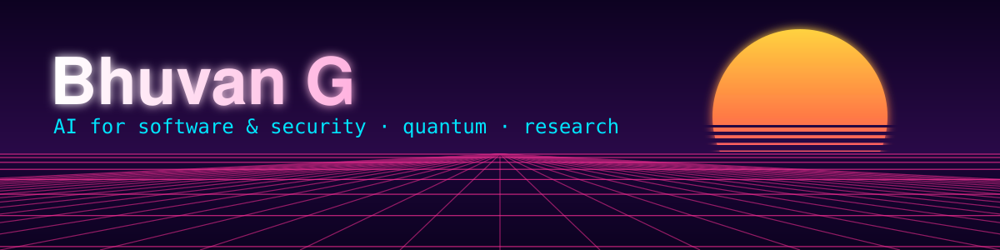

 

<table>
<tr>
<td width="38%" valign="middle"></td>
<td valign="middle">
<pre>
bhuvan@christ
--------------------------------------
Role:       BTech CSE-IoT (AI/ML Honours), 3rd year
Host:       CHRIST (Deemed to be University)
Location:   Bengaluru, India
Focus:      AI for software &amp; security
Research:   Adversarial ML · AI code review
Hackathons: CXO Infofest · SIH 2026
Code:       Python · TypeScript · C · SQL
Spoken:     English · Kannada · Hindi
Editor:     CASH Magazine
Contact:    gurubhuvan844@gmail.com
</pre>
</td>
</tr>
</table>

> 🔒 = private repository. Some of my best work lives in private repos (company internship code, an ongoing hackathon), so I describe it here instead of linking it.

---

## 🚀 Featured Projects

| | Project | What it is | Stack |
|---|---|---|---|
| 🔒 | **Multi-Agent AI Pull Request Reviewer** | Multi-agent system that reviews GitHub pull requests automatically. Built during an internship for a company, so the code is private. Basis for my code-review research (literature review done, fine-tuning planned). | `FastAPI` `Claude API` `Pinecone` `Redis/Celery` `Supabase` `Docker` `Next.js` |
| 🎲 | [**CertiRand**](https://github.com/bhuvang14/CertiRand) | Quantum random number generator as a service, built for the **CXO Infofest Hackathon**. | `Python` |
| 🔒 | **ECDAT** *(Smart India Hackathon 2026)* | Post-quantum cryptography discovery and migration tool: generates a Cryptographic Bill of Materials (CBOM) that inventories quantum-vulnerable assets across an organization, scores each by migration urgency (Mosca's theorem) and supports migration planning. Private until the hackathon concludes. | `Python` `CodeBERT` `tree-sitter` `CycloneDX` |
| 🎓 | [**Apprentice.ai**](https://github.com/bhuvang14/Apprentice.ai) | Faculty infrastructure manager: cuts the time faculty lose to repetitive documentation and compliance reporting (NAAC/NBA/IQAC) with auto-fill, report generation, deadline tracking and role-based access. | `Python` `React` |
| 🏋️ | [**Workout-DBMS**](https://github.com/bhuvang14/Workout-DBMS) | DBMS course project: a workout/gym database system built end to end, from schema design to queries. | `TypeScript` |

---

## 📚 Learning Projects (not on GitHub)

<b>Smaller things I built while learning. Click to expand.</b>

 

- 🎵 **Music recommendation system:** an early taste of ML applied to a real-world problem
- 🕷️ **Web scraper:** pulling and cleaning data from web pages
- 📅 **Work planner and diet tracker:** a desktop app built with Python's Tkinter
- 🔁 **Token Ring Network in C:** a simulation using a circular queue
- 🗄️ **SQL and file-handling projects:** database queries and file I/O fundamentals
- 📰 **Magazine-style portfolio website:** editorial design with a dark navy and brass-gold palette, serif type and scroll-reveal animations
- 🧩 **LeetCode practice:** two-pointer, stack, prefix/suffix, hash set and sliding-window patterns, working from correct code toward optimal code

---

## 🛠️ Tech Stack

---

## 🌱 Currently

- ⚙️ Building ECDAT for SIH 2026
- ✍️ Writing up the code-review research

Thanks for stopping by 👋

